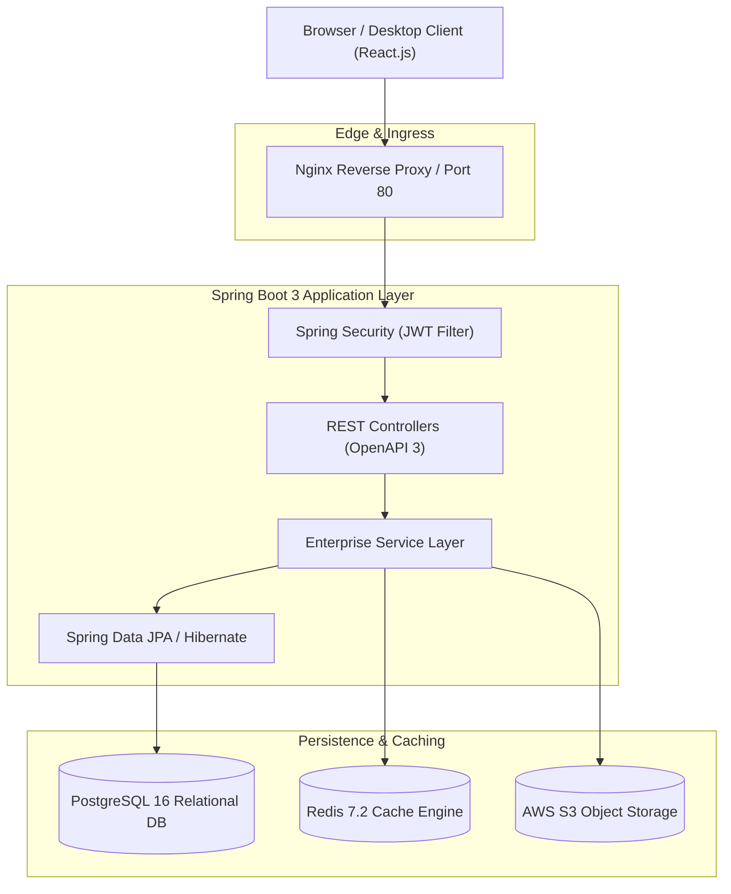
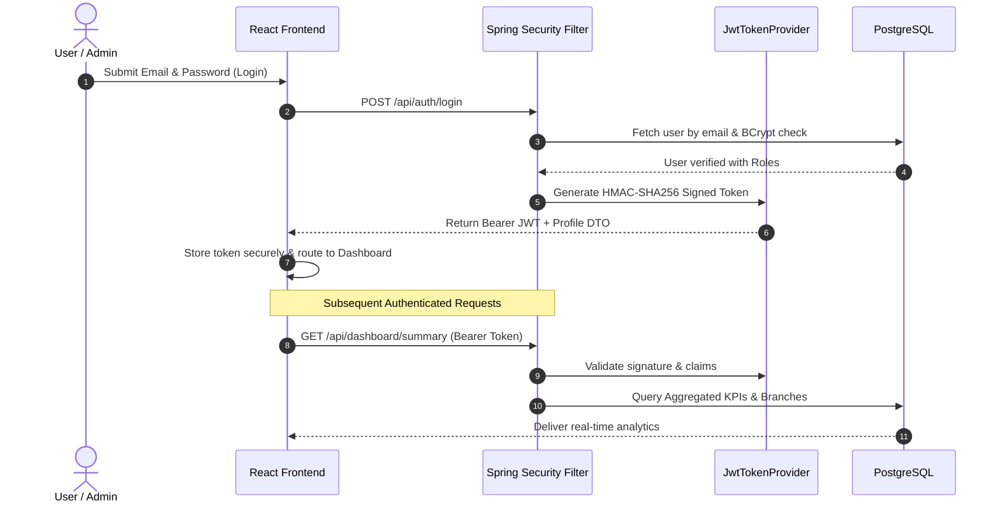
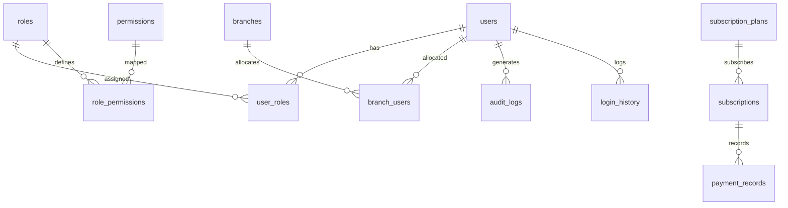

# TTC Fleet360 - Enterprise Architecture Specification

## 1. Executive Summary

**TTC Fleet360** is a mission-critical, enterprise-grade Fleet Management and Logistics Operations System designed to provide real-time operational visibility, telemetry monitoring, multi-branch depot coordination, and role-based access control.

---

## 2. System Architecture Diagram

---

## 3. Technology Stack Alignment

| Tier | Mandatory Technology | Implementation |
|---|---|---|
| **Frontend** | React.js, JavaScript, HTML5, CSS3, Responsive UI | React 18, Vite, Lucide Icons, Custom High-DPI Charts |
| **Backend** | Java 17, Spring Boot, Spring Security, Spring Data JPA, REST APIs | Spring Boot 3.2.5, REST Controllers, Swagger UI |
| **Database** | PostgreSQL | PostgreSQL 16 Normalized Schema + Migrations |
| **Caching** | Redis | RedisTemplate + Spring Cache (TTL 15 mins) |
| **Authentication** | JWT Authentication, Role-Based Access Control (RBAC) | JJWT 0.12.5 + BCrypt Password Encoder |
| **Cloud Storage** | AWS S3 | AWS SDK v2 S3 Client (Presigned & Bucket Put) |
| **DevOps** | Docker, CI/CD | Dockerfile, Docker Compose, GitHub Actions |

---

## 4. Security Architecture & RBAC Flow

---

## 5. Normalized Relational Database Schema

---

## 6. Enterprise Roles & Privileges

1. **Super Admin (`ROLE_SUPER_ADMIN`)**:
   - Complete system access
   - User creation, edit, deletion, status toggling
   - Role creation and permissions matrix management
   - Regional branch addition, decommissioning, and staff allocation
   - Subscription tier management, renewal processing
   - Company corporate profile and AWS S3 brand logo management
   - Complete audit trail and login history examination

2. **Admin (`ROLE_ADMIN`)**:
   - Operations oversight
   - User profile management
   - Branch status oversight
   - Reporting and analytics access

3. **Fleet Manager (`ROLE_FLEET_MANAGER`)**:
   - Vehicle diagnostics, route tracking, telematics monitoring

4. **Dispatcher (`ROLE_DISPATCHER`)**:
   - Active trip assignments, driver schedules, hub coordination

5. **Driver (`ROLE_DRIVER`)**:
   - Vehicle check-ins, trip logs, route navigation

6. **Technician (`ROLE_TECHNICIAN`)**:
   - Preventive maintenance, inspection reports, diagnostic logs
